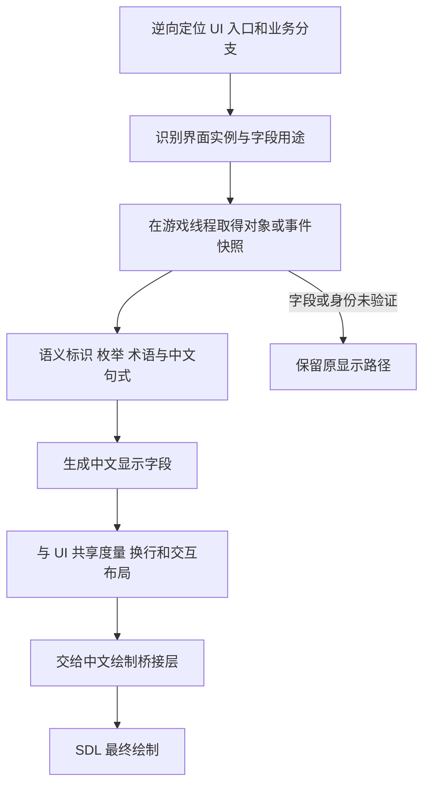

# UnReal World 汉化 Mod 设计案

> 2026-10-19 重建说明：本文件包含互相覆盖的历史方案和已不存在产物的交付记录，不能将“已实现/已发布”视为当前状态。当前实现规则见 [重建设计](rebuild-design.md)，冲突的具体位置与影响见 [重建合规审查](evidence/rebuild-compliance-audit.txt)。以下固定行槽、DisplayPlan、Present 叠字及原文本字节宽度方案均不再执行。字体质量要求继续有效。

2026-10-19 字体要求：现行规范见 [字体渲染](font-rendering.md)。保留指定字体、固定参考集校准、稳定包络、自然宽度、Blended 抗锯齿及实际输出密度生成字形；这些质量要求不授权全局像素跟踪、保存文字位置或在最终复制时重放。旧 font-design-compliance-static.txt 是代理实现记录，不能作为规范；该引用链及错误正文已更正，见 [出处记录](evidence/20261019-document-render-policy.md)。源码与交付状态以 [README](../README.md) 为准。

绘制边界：Mod 在反编译确认的 UI 组件文本读取处按组件语义生成中文，在该组件当次文字绘制调用中输出高清字形；游戏原生 UI 管理布局、控件及缓存。不得把历史实现记录中的内容镜像、绘制贡献或 RenderCopy 重物化当成这一要求的具体实现。

2026-10-18 用户最新要求优先：汉化须进入游戏原生 UI 的排版、绘制与缓存链，固定行槽和最终 present 叠字已撤除，上一阶段采用原生字体表供字（已由最新字形 Hook 取代），源码、编译和正式交付见 [文字链交付记录](evidence/native-ui-text-static.txt)，未运行验收；热重载须在任何游戏界面完成，不要求关闭当前窗口或返回主菜单。此前 Footer 限制和跨原生等待保留 adapter 调用帧的说明已撤销。当前通用桥整改及真实迁移限制见 [热重载设计](hot-reload.md)，既有实现的逐项问题见 [全量静态审查](evidence/native-ui-ownership-audit.txt)。

2026-10-18 当前架构修订将热重载管理与汉化业务隔离，采用 Host ABI `3`、通用驻留 `uwcn_loader.dll` 与六个独立可重载业务 DLL。新增 `adapter`（ID `6`、掩码 `32`）接管所有已确认界面的原生作用域、字段读取、显示调用适配、输入规则与补丁描述；字段组织、词库、中文语义、字号与排版、字体与 SDL 绘制分别归属既有五模块。驻留层只管理模块、稳定 x86 thunk / slot、控制 Hook、原函数透传、租约和发布交接，不再含各窗口汉化逻辑。

adapter 采用短 Before / 驻留原函数 / 短 After 调度，原生输入等待期间不保留业务调用帧或租约；其他五模块保持同步短调用。请求通过通用驻留事件与等待泵处理，不依赖当前窗口或主菜单。驻留 thunk / slot 进程期稳定，游戏不持久保存 adapter 函数指针。兼容的窗口汉化、字号、字体和补丁规则更新均热更相应业务模块；真实通用桥迁移限制须单独说明，不得冒充用户的界面使用限制。

五模块 / ABI `2` 到六模块 / ABI `3` 的迁移属于历史交付。本次任意界面重载桥已在用户退出旧进程后完成源码、统一队列编译及正式发布，未运行验收；详细回执见 [新桥交付记录](evidence/anywhere-reload-static.txt)。用户要求这是本轮整改最后一次退出，后续兼容更新使用统一编译队列和任意界面发布事务，原生 UI 所有权整改须在业务层完成。以下逐窗口接入段落保留迁移前历史与静态证据，涉及“新增驻留桥”的更新说明不再作为日常要求；仍不运行游戏、交付产物或测试。

2026-10-18 用户新增主菜单汉化组标识：启用汉化时，在原制作组标志左侧绘制与 dfcn 相同的 Byayoi 像素 logo，下方两行依次为“Byayoi同人社区汉化”和自动版本号。原制作组图像及文字保留。新增 `TranslationCredit=0x300` 与 `TranslationVersion` 两个字段，仍沿用语义、词库、布局和 SDL 流水线；本功能不扩展公共结构，随并行框架迁移采用 Host ABI `3`。logo 随 Render 显示计划持有和释放，以整数像素单元缩放；署名、版本中心为逻辑 x540，行槽分别为 `{480,566,120,12}`、`{480,578,120,12}`。Host 仅通过 `metadata/package-identity` 提供以 `UWCN_PACKAGE_IDENTITY_V1` 开头的六模块与词库身份原字节，`main_menu` 参考 dfcn 的 SHA-256 五位混合字母数字规则计算显示版本；旧 `metadata/translation-version` 入口移除。详见 [标识静态记录](evidence/main-menu-branding-static.txt) 与 [版本规则](evidence/main-menu-branding-version-static.txt)。本次只作静态实现与交付编译，不启动游戏或执行测试。

本次新增截图所示主菜单“先祖”列表页，完整反编译及静态调用依据见 [先祖列表记录](evidence/ancestors-static.txt) 与 [反编译输出](evidence/ancestors-ghidra.c)。`menu_op::ancestors` 沿既有五模块处理十一类固定字段及两种记录统计模板，每页最多七条；年龄、冒险天数、原生取整后的公里数和页数均在已确认格式化调用处复制，不解析英文句子。姓名、存档死亡描述、肖像、排序、分页、键帽和输入动作保留。独立纪念页及其他入口的死亡分支保持原生显示；列表计划在原重建调用更新，进入纪念页时暂停合成，返回后随原列表重建恢复。本次驻留桥需完整离线发布后由用户正常重启，不新增重载边界，亦不表示已运行验证。

用户最新截图新增主菜单“鸣谢与贡献者”窗口。经离线反编译提取标题、介绍、21 条致谢和按键提示，依据见 [鸣谢静态记录](evidence/credits-static.txt) 与 [完整反编译](evidence/credits-ghidra.c)。介绍和同胞名单分别显式分为三行，共 28 个显示字段；全部姓名保留原拼写。`menu_op::credits` 经既有语义、词库、布局和 SDL 流水线绘制，正文在原窗口内左对齐，标题及按键提示居中，字面预算沿用 9。驻留桥只围绕原 Credits 调用及其面板、正文、按钮建立局部作用域，保留原生段落解析、光标副作用、输入和窗口重绘。新增操作及字段不改变既有结构大小和 Host ABI `2`，不增加重载边界。本文只说明静态实现，不表示运行游戏验证。

用户最新授权新增截图所示完整开场序列。通过 Ghidra 完整反编译确认 `0x1254C0` 的两句星空字幕、版本文字，以及 `0x125370` 的十一句神话旁白，共十四个文本字段，原文、调用链及全部分支见 [开场静态记录](evidence/intro-static.txt) 与 [反编译输出](evidence/intro-ghidra.c)。新增 `menu_op::intro` 沿用语义、词库、布局、SDL 流水线，按原生当前行更新颜色并保留已显示行；中文使用现有字面上限，正文中心为逻辑 x400，版本中心 x398。原标志图片、背景、输入、计时和资源读取保持原样。

开场驻留桥仅在原启动调用作用域内工作。两句星空字幕跟随原生整行灰度渐入，在原两秒黑幕淡出期间按该帧黑表面 alpha 缩放中文字色，淡出返回后清空字幕快照。后续版本文字与十一句神话逐行累积，神话每行从灰度渐入到原黄色。版本值在原生版本读取调用返回后立即复制。逐帧色调通过 `SDL_SetTextureColorMod` 应用于开场白色字形与黑色描边，颜色变化复用字形资源。新增字段和操作不改变既有结构大小与 Host ABI `2`；驻留层及业务模块仍需配套离线发布，不新增开场重载边界。本文为静态实现说明，不表示已经运行游戏验证。

用户已明确将主菜单进入的“关于”窗口纳入当前范围，静态依据见 [关于窗口记录](evidence/about-static.txt)。驻留层仅在该动作调用作用域内抑制已确认的七类原文字段，保留网站、实际安装路径、底图、按钮和按键动作。中文沿用语义、词库、布局及 SDL 最终合成流水线，首次显示与窗口事件重绘共享同一 About 计划；代码及数据交接仍等待返回既有主菜单边界。本段为静态实现说明，不表示已运行验证。

启动加载进度的完整静态提取见 [全部音频加载文本记录](evidence/startup-audio-static.txt)：保留原英文业务调用，在已确认的 7 个显示调用点生成中文，覆盖 109 个可见音频名称及原有失败提示。该增量仅作用于启动阶段，SDL 完成最终绘制。

当前工作范围以 `AGENTS.md` 和用户最新要求为准，包含框架、启动加载提示、完整开场、主界面、设置界面的全部文本，以及已授权的关于、鸣谢、退出告别页与先祖列表页；角色创建、读档、物品、百科及其他未经授权界面的内容不进入本次工作。设置界面必须通过反编译提取全部文本，按已确认的显示路径生成中文，依据见 [设置文本静态记录](evidence/setup-options-static.txt)。退出告别页已获用户明确授权，依据见 [退出告别页静态记录](evidence/farewell-static.txt)。模块拆分与增量构建采用 [模块化框架设计稿](framework-design.md)，其中将本文的单个可替换核心细分为独立业务 DLL；主界面绘制以 [布局修订记录](evidence/main-menu-layout-fix.txt) 为当前基线，启动加载文字依据见 [启动加载静态记录](evidence/startup-loading-static.txt)。

设置界面扩展只改变显示文本，原选项值、输入动作和配置保存语义由游戏保留。下文物品与事件相关段落是历史设计背景，不构成本次实现或运行核验要求；本次不启动或操作游戏，不写测试、测试脚本或代码断言，编译仅用于生成交付产物。

退出告别页在已确认的退出函数作用域内构建标题、四行引文及署名、献词、三行寄语和按键提示共 11 个中文字段。原背景、标题框、按钮及按键退出动作保留；原文仅在对应文字显示边界抑制，中文由布局模块排布并在原 SDL present 前合成。此次涉及驻留桥更新，正式发布后由用户完全退出游戏并正常重启生效，不新增退出页重载边界。

本设计面向 Steam Windows 版 UnReal World 3.89，首个适配目标为 Build ID `25939378`。本机证据见 [游戏分析](game-analysis.md)，业务调用链见 [UI 静态逆向记录](evidence/ui-semantic-analysis.txt)。

**主路线是逆向识别 UI 业务与对象读取路径，在 UI 构建显示字段时，根据界面用途和对象信息生成中文。** 翻译决策以界面、字段角色、对象类型及属性为输入；英文仅在需要保留原显示、处理自由文本或诊断时使用。SDL 负责最终绘制，不负责捕获原文或判断文本语义。

**首版同时支持数据和核心代码热重载。** 参考 dfcn，采用驻留加载器与可替换核心，跨代保存 UI 语义和事件数据，重新建立中文布局。完整协议及源码依据见 [热重载设计](hot-reload.md)。

## 目标和首版范围

首先完整理解一个物品界面的数据流：谁打开界面、列表行对应哪个对象、对象描述如何取得、哪些字段负责名称和分类、哪些代码负责布局与选择。先以物品分类标题证明语义翻译，再扩展到对象名称和描述、历史消息与长文本。

| 显示内容 | 翻译依据 |
| --- | --- |
| 菜单和固定标签 | UI 功能标识、动作标识、字段角色 |
| 物品分类标题 | 当前列表的分类码与 UI 分组用途 |
| 物品名称与详情 | 对象原型身份、数量、材料、品质、状态，以及该界面允许显示的信息；具体字段逐项逆向确认 |
| 玩家和 NPC 状态 | 当前状态界面的字段角色、单位与相应属性快照 |
| 战斗日志和动态消息 | 事件类型、已选分支和事件发生时的对象及数值快照 |
| 百科与长描述 | 稳定主题键、段落角色和参数 |
| 自由姓名及玩家输入 | 原有可见名称作为参数，默认保留 |

运行时使用本地术语、枚举映射和中文句式。中文输入法、存档内中文命名作为后续范围。

## 语义翻译架构

### 主数据流



例如，物品列表需要显示分组名称时，输入是 `ui=item_list`、`field=group_heading`、`category_code=1`，输出“武器”。不需要先捕获英文 `Weapons` 再查整句词库。同一对象出现在背包、交易和制作界面时，可以根据字段用途选择名称、数量、容器或价格等不同中文视图。

更复杂的名称同样从已验证属性生成。对象原型、材料、品质和数量的字段偏移尚未确认前，不预先声明它们的布局；不得根据某个内存数字看起来相似就纳入翻译。字段不足时保留原显示。

### UI 的识别方式

本机原生程序未必有统一 UI 类或控件树。界面可能由普通函数、全局状态、状态机分支和局部行记录共同实现。通过操作入口、调用链、对象来源、分支和显示消费者确认 UI 功能，再为 Mod 定义稳定标识。

识别证据应回答：哪个动作进入此界面；哪个索引或句柄确定当前对象；数据来自哪个表或函数；返回数据最终用于分类标题、名称、状态还是游戏规则。屏幕坐标、最终英文和共用绘制函数只能辅助核验，不能独立决定 UI 身份。

UI 语义 ID、对象 ID 和字段角色分别建模。`inventory.group_heading` 是 Mod 定义的显示语义，不要求游戏内已存在相同字符串 ID；它必须对应已确认的业务分支。

## 本机已有的业务定位线索

以下来自静态反汇编，业务命名为候选，尚未完成运行时核验。

| RVA | 静态证据 | 拟调查职责 |
| --- | --- | --- |
| `0x58E30` | 使用背包携带提示及 examine 文本，调用 `0x55060`，选择后读取行记录并进入 `0x48EF0` | 背包浏览及检视入口 |
| `0x55060` | 共享物品列表调用目标，接收模式和列表来源等入参 | 列表控制与选择流程 |
| `0x54160` | 读取每行记录，调用 `0xC0190` 取得对象描述，再按首字节分组 | 物品列表呈现与字段构建 |
| `0x48AD0` | 根据输入分类码选择标题；调用点 `0x54337` 位于上述列表路径 | 分类名称查询；首个语义 PoC 的观察点 |
| `0x48EF0` | 从所选索引关联对象 handle，读取对象描述，按类别分支 | 物品检视及详情 |
| `0xC0190` | ECX 为 handle，向调用方缓冲复制 `0xAC` 字节描述 | 对象描述读取器，不全局替换其返回值 |
| `0x51770` | 从 handle、第二整数及格式标志构造文本，返回共享文本池指针 | 共用名称或描述构造器，需要核查 UI 与非 UI 调用方 |

拟深入确认的链条是：

```text
背包浏览入口 0x58E30
  → 物品列表控制 0x55060
    → 列表呈现 0x54160
      → 行记录中的对象 handle → 对象描述读取 0xC0190
      → 描述首字节 → 分类名称 0x48AD0 → 分类标题显示
  → 选中行记录 → 详情入口 0x48EF0
    → 对象 handle → 对象描述 0xC0190 → 描述构造 0x51770
```

不是每条箭头都已经证明为直接函数调用；列表控制到呈现的完整关系、各入口在当前界面的实际执行情况及对象生命周期，均属于下一步的核验内容。

首个替换应限定为 `0x54160` 内分类查询 `0x54337 → 0x48AD0` 至标题消费 `0x5434B → 0x1157B0` 的业务链，并接通对应中文布局；不能仅在查询处返回 UTF-8 指针后继续走旧点阵路径。即使 `0x48AD0` 返回分类英文，也不直接把该共用查询函数的所有返回值改成中文。相同原则适用于对象名称 getter。

这一局部链在 `0x54342` 还使用 EDX 计算坐标，调用后有 `add esp, 0xC`。适配层必须保存原链依赖的寄存器及参数清理行为，不能让普通 C++ 格式化调用破坏尚在使用的坐标值。

## 逆向和 Hook 方法

### 地址与结构定位

先按 EXE 哈希建立构建适配，再通过文字常量、资源键、调用交叉引用和反编译数据流定位 UI 业务函数。模块基址只解决函数和全局数据的重定位；识别 UI 还需要业务链和数据流证据。

代码和全局表采用实际模块基址加 RVA 定位；堆对象则从已验证的句柄表、对象参数或容器取得。禁止将函数 RVA、静态表地址和动态对象指针混作同一类“基址”。跨版本使用函数和结构双重校验，不能只更新一个地址后沿用全部字段偏移。

每项字段记录基址来源、偏移、宽度、符号性、取值范围、读写位置和显示用途。反编译得到的变量名与结构体定义是分析假说，要用多处访问和运行时样本交叉验证。

### 验证顺序

1. 选定背包分类标题，建立动作入口、列表行、对象描述、分类码及标题消费者的语义地图。
2. 在游戏自身业务入口和数据读取调用点设断点或只读探针，记录界面操作、参数、对象来源、快照和后续用途；不依赖 SDL 回调采集文字。
3. 在同一 UI 中切换多种对象，核对分类、数量、名称和识别状态；再让同一对象出现在其他 UI，判断哪些读取器为共用逻辑。
4. 每个入口记录真实 ABI、寄存器和栈参数、调用方清栈字节数、返回值、所有权和副作用，先通过透明透传。
5. 在明确的 UI 字段构建边界增加中文视图，同时接通该字段的测量、绘制和交互布局。

### Hook 优先级

| 边界 | 作用和选择 |
| --- | --- |
| UI 专用字段构造或显示模型 | 首选；已知界面、对象和字段角色，适合生成中文视图 |
| UI 内共用读取器的特定调用点 | 次选；只处理已确认的显示用途，保留读取器其他调用者 |
| 事件入队及消息实例构造 | 捕获事件类型、分支和当时参数，用于历史消息 |
| 共用对象描述或名称 getter | 观察对象来源和字段，不全局改写内部语义 |
| 通用文字与字形函数 | 仅承担输出兼容和布局适配，不决定对象或翻译语义 |
| SDL API | 仅作最终绘制后端，不作原文采集和 UI 识别入口 |

如果 UI 在调用共用 getter 时需要作用域上下文，应使用可嵌套的调用栈和精确字段标记，异常及重入都要恢复；不能设置一个“正在画 UI”的全局开关，让期间所有名称读取都返回中文。优先建立独立中文显示字段，保持底层原文和游戏逻辑不变。

### 工程选择

运行时拟用 C++20、CMake、MSVC Win32 和 x86 DLL。候选函数存在混合寄存器传参及调用方清栈，不能统一声明为标准 `__fastcall`。逐函数编写薄适配层，在进入普通 C++ 前保存原始上下文，确保 trampoline 的寄存器、栈、返回值和副作用契约成立。

内部 inline Hook 首选支持 x86 指令搬移的 MinHook，固定依赖版本并检查安装结果；它不会自动解决自定义 ABI、字段布局或 UI 生命周期。[MinHook 官方仓库](https://github.com/TsudaKageyu/minhook)

启动器提供原版、只读诊断和汉化模式；进程内采用驻留 `uwcn_loader.dll` 和可替换 `uwcn_core.dll`。启动器和驻留层职责分开，验证目标进程和模块指纹，不覆盖游戏 SDL DLL。若需在首次 UI 数据生成前加载，再实现并验证启动加载、Steam 环境、工作目录及参数传递。

## 模块和数据契约

| 模块 | 职责 |
| --- | --- |
| `resident_loader` 与 `HookHost` | 通用驻留控制、稳定 x86 入口、原函数透传、模块租约、交接字节和安全退役 |
| `adapter` 与其他五个业务模块 | UI 原生适配、已确认字段读取、语义生成、布局与绘制；兼容 ABI 下可分别更换 |
| `build_profile` | 代码和数据 RVA、字段布局、ABI、指纹及验证规则 |
| `ui_adapter` | 识别 UI 功能和字段角色，将显示实例绑定到具体对象或事件 |
| `entity_reader` | 在已确认的线程和稳定区间读取对象，生成可见信息快照 |
| `event_capture` | 在事件形成时冻结参数、可见名称和分支 |
| `semantic_formatter` | 枚举映射、术语组合、单位和中文句式 |
| `display_model` | UI 中文视图、布局事务和原显示回退 |
| `layout` 与 `render_bridge` | 中文度量、换行、字形及最终 SDL 绘制 |
| `diagnostics` | 语义覆盖、字段证据、对象关联错误和性能计数 |

以下是 Mod 内部模型草案，不表示已还原同名的原游戏结构：

```text
UiTextRequest
  ui_id                 已验证的界面功能
  ui_instance           界面或面板实例与生命周期代数
  field_role            分类标题 名称 数量 状态 历史消息等
  semantic_id           对应已验证业务分支的显示语义
  entity_view           本次界面可见的对象属性快照
  event_view            可选的事件发生时快照
  display_options       简略 全称 数量 容器等已确认显示选项
  original_display      可选的原始显示与编码信息
  layout_binding        区域 行列 选择 热键 滚动与几何返回值

EntityView
  identity              经验证的世界及对象身份 或仅本次调用有效的引用
  revision              经验证的对象修订 或本次快照内容摘要
  classification        已验证的类型和分类
  visible_attributes    生成该字段所必需且原 UI 可见的属性
  knowledge_state       已识别 未识别 可见别名等

DisplayPlan
  display_instance_token
  core_and_catalog_generation
  immutable_request_and_catalog
  font_and_target_generation
  translated_fields_and_lines
  metrics_clip_hit_regions
  render_resources_and_fallback_decision
```

测量、绘制、分页和命中查询共享同一计划。显示实例标识来自界面生命周期、字段和内容修订，不能由最近一次调用或裸对象地址猜测。词库、对象快照和字体配置在同次布局中冻结。

## 对象与事件的语义规则

### 真实属性与可见信息

对象读取器按逆向证据取得真实值，同时遵循当前 UI 的信息可见性。未知植物、未鉴定物品或被隐藏的属性应继续使用原 UI 的可见别名；汉化不应因读到内部真值而改变玩家获知的信息。

不要为了补齐属性调用未经证明无副作用的 getter。随机生成、懒加载、缓存更新和剧情状态读取都可能发生在名称或描述函数内。优先复制原 UI 已读取的数据，或验证读取器后再调用。

`0xC0190` 无效句柄路径会返回共享暂存描述的现存内容，因此不能仅凭“返回了一个指针”认定对象有效。需要先确认句柄范围、对象是否存在，以及输出描述与当前行的关联。

### 生命周期和并发

在游戏实际的生产或 UI 消费线程、已证明稳定的调用区间生成不可变快照。工作线程只处理副本，不在后台追踪游戏裸指针。重入可能使多次字段读取跨越一次状态变化，需读取版本前后核对，或限定在原函数已有一致性保证的区间。

跨帧对象身份使用经验证的世界代数、对象 ID 与对象生命周期代数。若游戏没有可靠代数，也无法完整观察创建和销毁，则指针仅限单次调用使用，跨帧缓存改用快照内容及显示语义。读档、新世界、界面销毁都要清理相应关联，防止地址复用后串对象。

`0x51770` 返回的是共享环形文本池槽，而非已经确认的对象自有字符串。若需保留其原显示，必须在 UI 调用范围立即复制；不得缓存返回裸指针，或在后台稍后解引用。

### 历史消息

事件入队时记录类型、已选分支、角色关系、当时可见名称和数值。重绘旧战斗日志时使用该事件快照，不能读取对象当前装备、伤势或名称重新造句。对象死亡、物品销毁或读档后的地址复用不得改写原有历史。

无法取得事件语义时保留原显示。对最终英文的精确映射只作为已限定来源的兼容适配，不作为对象识别或补造历史参数的手段。

## 语义词库和中文生成

词库由界面固定字段、分类和状态枚举、原型术语及中文句式组成。匹配键优先采用 `ui_id + field_role + semantic_id + display_options`，对象属性作为参数。若原型身份只能由稳定英文内部 token 表示，可将其作为经验证的术语键，不对屏幕整句猜测实体。

首个分类标题示例：

```json
{
  "ui": "item_list",
  "field": "group_heading",
  "semantic_id": "item.category",
  "enum": {"1": "武器", "2": "防具与衣物", "3": "容器"}
}
```

这些分类映射已有静态标题分支依据，实际 UI 覆盖与调用约定仍须动态核验；它们不是完整物品类型枚举。后续物品名称模板只有在对应字段还原后才启用。

外置 messages、百科和菜单资源用于建立语义和术语索引。保留消息 ID、分支、操作码、配方匹配 token 与音效行为；中文只进入相应显示视图。命名参数由 Mod 格式化，避免向原 C 可变参数函数传入改变参数顺序的中文模板。

离线校验器检查重复语义键、未知枚举、参数类型、模板完整性、行为 token 和发布状态。运行时只查询本地数据，不在 UI 或绘制线程调用网络翻译。

## 中文字体和原生排版

现行质量要求以 [字体规范](font-rendering.md) 为准。使用指定的系统微软雅黑粗体与游戏同一 SDL 实例对应的字体后端，统一校准字面、稳定包络、自然宽度和基线。排版、居中、换行、行距、控件尺寸及命中由原生 UI 决定，Mod 不建立字段槽位或独立页面计划。

文本经已确认的组件读取、格式化或消费接口返回原生 UI；真实度量接入原生宽度计算。Mod 在该组件当次文字绘制调用中，向已确认的原生目标即时提交按实际输出密度生成的字形。原生 UI 随后管理表面、纹理及其复制、覆盖、上传、重绘和销毁。

禁止扫描全局表面像素或跟踪通用逐像素写入，禁止为原生资源另存像素和文字贡献序列，禁止在 RenderCopy 或 Present 时根据旧文本和位置重建画面。字体自身缓存不含页面布局和 UI 位置；低分辨率文字放大不满足高清要求。未确认原生高清目标的部分须继续反编译并明确记录缺口，不擅加保护、回退、断言或推测接口。

旧文的固定行槽、Present 合成、独立布局与重放方案均已撤销；完整修改前文档已归档于 `回收/20261019-document-render-policy-5e1fcbfd/docs/design.md`。

## 内存与运行时约束

游戏原始数据只读；按已验证的 UI 对象读取路径取得所需字段，不扫描整个进程内存。需要保留原显示或处理自由文本时，才有界复制其原始字节，并记录来源、编码及处理阶段；重映射后的点阵槽索引不能当成原始字符编码。未知或非法序列保留原显示，不能对所有来源强制使用 UTF-8。

译文由 Mod 自己持有。若已证明原函数同步消费，可用本次调用持有的不可变对象；如果 UI 保留指针，译文字节由驻留层 arena 持有并绑定到明确 UI 生命周期，避免核心热重载释放它。未知持有时长时不开放指针替换。单个 `thread_local std::string` 或会扩容的容器不能承担长期指针稳定性。

已发现的整串路径会先把英文复制到约 300 字节的局部区域，再按字节绘制。语义生成的中文直接绕过该缓冲，使用自己的布局与字形路径；原显示兼容适配若需复制文字，应在旧复制发生前处理。复制后的 LF 偏移检查不是安全复制上限，不能将约 300 字节当作允许写回的容量。没有明确容量的写回和原地扩长全部禁用。

语义生成缓存的键包含 UI、字段角色、语义 ID、显示选项、可见属性快照和词库代数。稳定对象身份及修订未被证明时，不以对象地址替代快照；对象发生变化必须生成新的视图。原显示兼容缓存另含来源、编码和处理阶段。布局缓存再加入字体、字号、宽度、样式和缩放；绘制资源缓存加入具体 renderer 或 surface 的身份与代数。设置条数和字节上限，淘汰时确保没有仍在使用的引用。字体操作首版也收敛到绘制所属线程。

Hook 内不进行网络请求或同步磁盘写入。语义快照的诊断副本通过有界队列交给工作线程，队列满时丢弃诊断并计数，不阻塞游戏。覆盖统计按 UI、字段和语义分支计算，不按 SDL 调用次数或重复描边计数。递归保护使 Mod 自己的绘制调用直接走原 trampoline。DLL 初始化只做最小工作，重初始化和 Hook 安装由明确生命周期管理。

可预期的词库、字体或布局失败在绘制前决定回退；C++ 异常不得越过 ABI 边界。访问违规、栈破坏等原生错误不能靠通用异常捕获假装恢复，必须通过限定入口、有界读取与透明探针提前排除。

普通显示开关仅切换为原文透传，保留核心和数据。核心重载则按驻留层协议退役旧代、传递状态并加载新代；不在 Hook 或旧核心栈上卸载。退役失败保留仍被引用的代码，加载失败保持原文及可重试的控制入口。具体状态与错误处理见 [热重载设计](hot-reload.md)。

## 版本适配与交付结构

每个适配包记录 EXE SHA256、位数、相关 DLL 指纹、已验证的代码及数据 RVA、入口指令、ABI、行记录和对象字段布局、枚举及 UI 适用范围。Build ID 用于诊断；函数和数据结构都通过校验才启用对应语义适配。ASLR 下使用实际模块基址加 RVA，禁止写死首次运行的绝对 VA。

未知构建默认只允许静态检查或明确的只读诊断，不安装修改 Hook。若采用特征扫描，应先限定已知模块和区域，要求唯一匹配、入口及调用关系校验；“找到类似字节”不足以开启汉化。

拟议目录如下，当前尚未创建这些运行时模块：

```text
src/launcher/            启动与目标进程选择
src/loader/             驻留加载器与 HookHost
src/core/               可重载核心及状态序列化
src/adapters/           按构建和 UI 适配的 ABI 与字段读取
src/semantic/           对象及事件快照 枚举 术语 中文句式
src/text/               字符串兼容 编码 标签
src/layout/             度量 换行 交互区域
src/render/             SDL surface 与 renderer 桥接
catalog/zh-CN/          语义字段 枚举 术语与句式
profiles/               构建指纹 函数及数据布局
tools/                  只读检查 抽取 校验 回放
docs/evidence/          脱敏定位记录和基线
```

发布包包括驻留加载器 DLL、可重载核心 DLL、启动器、离线词库、字体及许可、适配配置和诊断说明。数据修改直接刷新；兼容核心代码更新可以热重载；驻留层或 ABI 变更正常重启后生效。卸载通过移除 Mod 文件和启动配置完成，运行时翻译不写回配方、原型和存档。

## 开发阶段与验收

| 阶段 | 产物 | 进入下一阶段的条件 |
| --- | --- | --- |
| G0 静态语义地图 | 背包入口、行记录、对象读取、分类和显示消费者 | 当前已有候选链；记录事实与假说及字段依据 |
| G1 业务链动态核验 | 背包分类、选择、详情的参数、对象快照及 ABI | 切换不同对象并跨 UI 对比；确认句柄有效性、可见性和调用用途 |
| G2 UI 透明探针与重载骨架 | 原行为透传，驻留层与兼容核心交接 UI 及事件数据 | 确认安全调度边界、入口租约和退役协议；没有 SDL 文本捕获依赖 |
| G3a 分类语义 PoC | 分类码直接生成中文标题及完整布局 | 不依赖最终英文匹配；其他玩法调用保持原值；布局与选中区域一致 |
| G3b 对象字段扩展 | 还原并翻译一个具体对象名称或状态字段 | 字段含义、可见性及显示选项已经核验；同对象跨 UI 不串格式 |
| G4 对象与事件生命周期 | 对象切换、删除、读档验证；一条事件快照消息 | 无地址复用和串对象；历史消息不随现状变化；未知属性不提前显示 |
| G5 完整面板与首版 | 一个物品列表、一个长文本窗、语义词库工具和适配包 | 分页滚动、两种绘制路径及失败恢复通过；未知构建拒绝修改 |

G3a 是该语义路线的首个实证点，G3b 在其后独立推进对象属性还原。未证明返回值仅用于显示，不允许让它全局返回中文；未证明对象身份或事件参数有效，不从当前内存补造缺失信息。只有字体绘制成功而没有 UI 和对象关联，不能算语义 PoC 通过。

验收使用新建的专用测试角色。记录窗口分辨率、缩放、渲染驱动、游戏指纹、词库代数和操作序列；不使用随机截图比较代替可复现步骤。

| 场景 | 通过标准 |
| --- | --- |
| 主菜单、弹窗、选中项 | 中文清楚；热键、导航、高亮和鼠标命中一致 |
| 动态消息与战斗日志 | 数量、名称、伤口、部位和参数不丢失；扩展字节重映射和混合姓名正确 |
| 物品、制作、交易 | 中文显示可用；原型匹配、暂停恢复制作和交易结果正常 |
| 同一对象出现在不同 UI | 按字段用途显示简略名、数量或详情；不把一个界面的格式带入另一界面 |
| 未识别对象和隐藏属性 | 仍使用该 UI 原本可见的信息；不提前显示内部真实类别或属性 |
| 删除对象、句柄复用、读档 | 不读旧指针、不用无效句柄的暂存结果，不串对象 |
| 历史事件后改名、换装或损毁 | 旧消息保持事件当时的显示与参数，不按当前属性重构 |
| 百科、多行描述、翻页 | 无按字节断裂；中文断行可读；链接、滚动和分页正确 |
| 软件表面与 renderer 路径 | 默认驱动和软件模式分别验证；设备或目标重置后正确重建；无跨 SDL 实例对象 |
| 不同窗口大小和缩放 | 逻辑坐标一致；无裁剪、拉伸或点击区错位 |
| 空串、非法编码、过长文本、缺字体、词条未命中 | 不越界；在修改任何绘制状态前选择原文回退 |
| 连续切换界面与词库热更新 | 同次测量绘制同代；预热后重复操作的 CPU/GPU 内存和对象数量趋于稳定 |
| 已打开界面的核心热重载 | 页面和历史数据保留；自动重新布局重绘，无需重新打开界面 |
| 数据刷新与兼容代码更新 | 各走对应更新路径；错误候选不替换现有数据，活动旧代不被强制卸载 |
| 保存、载入、关闭汉化、原版重启 | 内部英文规则和存档格式保持可用，原版可正常继续 |
| 错误 EXE 指纹和入口校验失败 | 不安装修改 Hook，给出可定位的诊断原因 |

布局验收同时记录度量宽高、实际绘制包围盒、下一行坐标、裁剪区与交互矩形，按同一逻辑坐标系核对；不能仅凭截图看起来相近通过。单个入口或单种后端通过不外推到其他路径。

性能先在 G2 记录基线，再比较相同操作。初始工程预算为：热缓存单次翻译加布局查询 P95 小于 0.1 ms、文本重绘窗口的帧耗时增幅 P95 小于 2 ms、CPU 词库及布局缓存不超过 32 MiB、GPU 文字纹理预算不超过 64 MiB。以上是待测目标，不是现有性能结果；超过预算时优化采集、批量合成和缓存，不牺牲指针正确性或中文字形。

## 当前决策

先核验背包业务链、`0xAC` 对象描述和可执行核心交接的原生调度边界，从透明探针阶段建立驻留层与可重载核心；随后在分类标题的 UI 消费边界，以分类码直接生成中文。下一步逐项还原物品名称和状态字段，并接入中文布局。核心门槛是**证明 UI 字段与对象或事件的关联及生命周期，同时保证热重载不会丢失语义数据或释放仍在使用的代码**。


