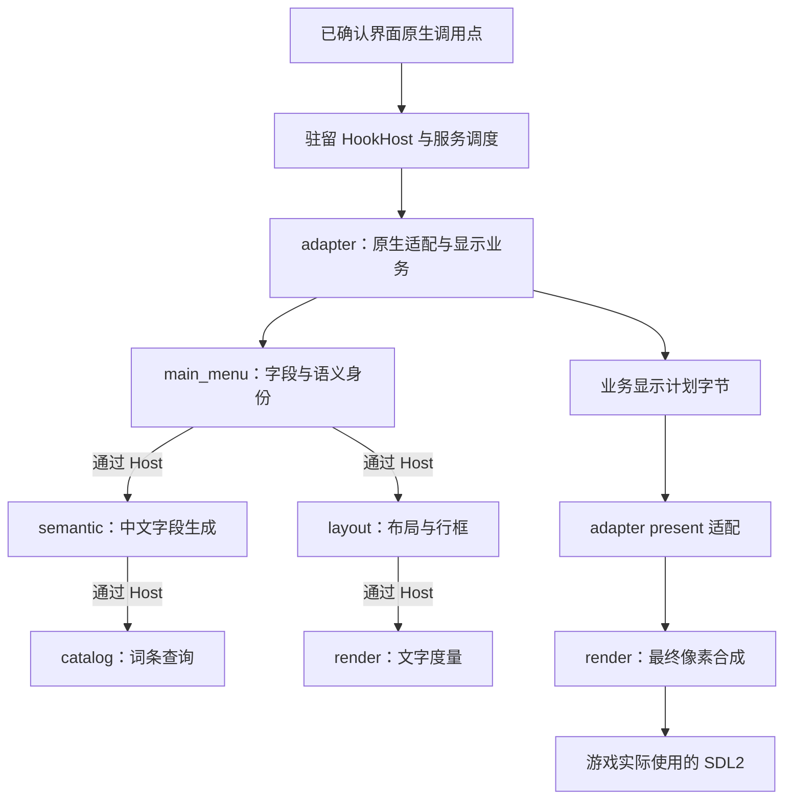
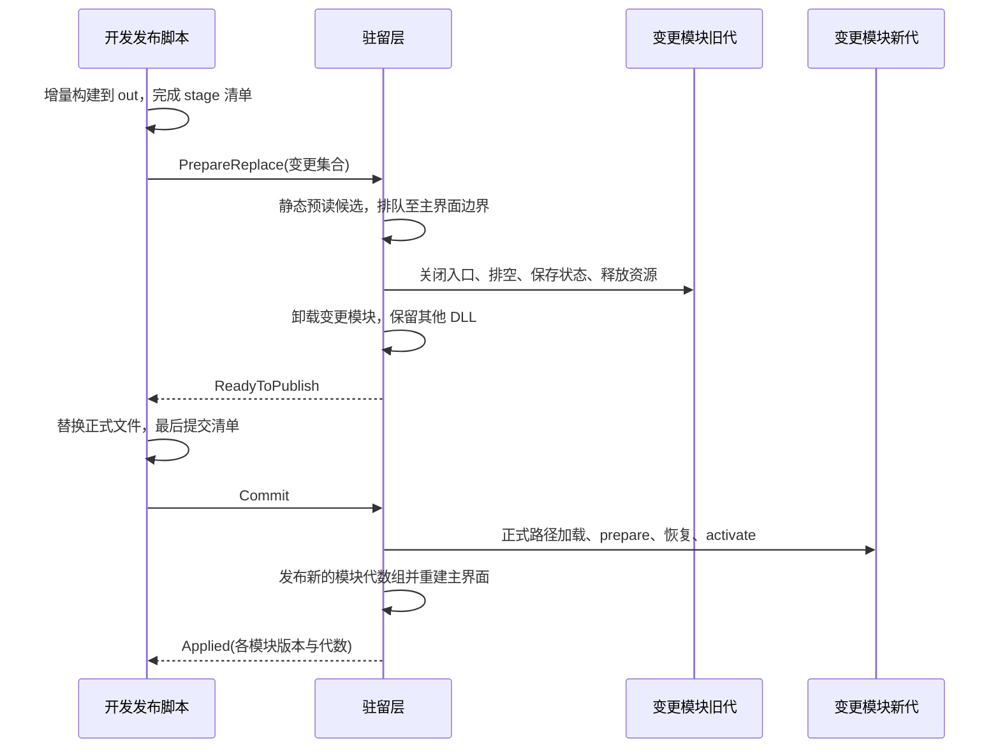

# URWCN 模块化框架设计稿

> 2026-10-19：以下为历史设计记录，旧源码和交付物现已不存在。重建采用独立 ABI 1，不能将历史 ABI 3 或旧“已发布”说明套用于当前产物。当前规则见 [重建设计](rebuild-design.md)；跨原生等待持有业务调用帧、Footer 才能交接、DisplayPlan 与几何反写的旧段落不再执行。

2026-10-19 字体要求：现行规范见 [字体渲染](font-rendering.md)。保留指定字体、固定参考集校准、稳定包络、自然宽度、Blended 抗锯齿及实际输出密度生成字形；这些质量要求不授权全局像素跟踪、保存文字位置或在最终复制时重放。旧 font-design-compliance-static.txt 是代理实现记录，不能作为规范；该引用链及错误正文已更正，见 [出处记录](evidence/20261019-document-render-policy.md)。源码与交付状态以 [README](../README.md) 为准。

绘制边界：Mod 在反编译确认的 UI 组件文本读取处按组件语义生成中文，在该组件当次文字绘制调用中输出高清字形；游戏原生 UI 管理布局、控件及缓存。不得把历史实现记录中的内容镜像、绘制贡献或 RenderCopy 重物化当成这一要求的具体实现。

2026-10-18 最新要求：重载可在任何游戏界面发起并完成，不得要求退主菜单、关闭窗口或手动卸载。此前本文的 Footer 限制已撤销。当前通用桥采用短 Before / 驻留原函数 / 短 After，以及不按界面筛选的 SDL 事件等待服务泵；adapter 调度协议和状态模式为 `2`，HostApi ABI 仍为 `3`。详见 [当前热重载设计](hot-reload.md)。本文以下旧窗口实现和原独立显示计划不作为现行 UI 所有权要求；原审查项已完成原生文字链源码、编译和正式交付，未运行验收，见 [交付记录](evidence/native-ui-text-static.txt)；[静态审查](evidence/native-ui-ownership-audit.txt) 保留初次发现。

2026-10-18 当前修订将热重载管理与汉化业务分开：`uwcn_loader.dll` 只链接 `host.cpp`、`hook_host.cpp` 与 `control_bridge.cpp`；全部 `native_*` 界面适配归属第六个业务模块 `uwcn_adapter.dll`。驻留 HookHost 接收通用补丁描述并持有稳定 x86 入口、原函数调用与返回路径，通用控制桥服务 SDL 事件与等待，不识别具体 UI。界面字段和调用适配均由可重载业务实现。旧独立中文计划、固定行槽及几何反写已撤除，当前通过原生文字构建点与 Mod 字形 Hook，由 Mod 绘字、游戏管理 UI 缓存。下文开头的五模块窗口接入段落是此次迁移前的历史说明，更新方式以本节及模块表为准。

Host ABI 保持 `3`，adapter 服务与状态模式为 `2/2`。`adapter` 的模块 ID 为 `6`、掩码为 `32`，六模块总掩码为 `63`。它与 `catalog`、`semantic`、`render`、`layout`、`main_menu` 使用同一生命周期、代数、租约、队列和正式发布事务；兼容的原生补丁描述变化随 adapter 退役、登记和激活，不要求改驻留代码。新桥已在用户退出旧进程后完成统一队列编译和正式发布，未运行验收，回执见 [新桥交付记录](evidence/anywhere-reload-static.txt)。用户要求这是本轮整改最后一次退出；后续汉化、字体、度量、显示适配和原生 UI 所有权整改须通过业务热更，在任意游戏界面交接，不依赖主菜单或逐窗口白名单。

本次新增先祖列表适配，静态依据见 [先祖列表记录](evidence/ancestors-static.txt)。`native_ancestors.cpp` 仅围住主菜单列表入口，`menu_op::ancestors` 通过 `AncestorsRequest` 向既有五模块传递原生分支、页数及每页最多七条记录的年龄、冒险天数和公里数；中文包含十一类固定字段及两种统计模板。姓名、存档死亡描述、肖像、排序、分页和输入动作保留。列表计划在原生重建后、首次 present 前生成，业务调用租约不跨输入等待；独立纪念页暂停列表合成并保留原显示。新增操作及字段保持 Host ABI `2` 和既有结构大小，驻留桥需完整离线发布后由用户正常重启，不新增重载边界。本段为静态实现说明，不表示运行验证或交付完成。

2026-10-18 修订：驻留几何适配已改为消费 layout 提交的七个主菜单行框，标签坐标、选择框、鼠标命中及面板尺寸随同一次计划更新。业务发布接收模块数组并使用单一事务；`-Reload` 不再读取未选择的驻留构建产物。MSVC 导出文件仅在内容变化时更新，避免每次配置无谓重新链接驻留 DLL。静态分析与交付状态见 [热重载修订记录](evidence/hot-reload-fix-static.txt) 及 README。

用户另已授权“关于”窗口。驻留 About 作用域围住主菜单动作 `0x125E39 → 0x1247C0`，`menu_op::about` 使用 `AboutRequest` 传入原生版本读取器的实际返回副本与版权年份，经既有五模块生成七个中文显示字段；网站和原生截断后的安装路径继续原样绘制。业务调用租约在进入原生等键函数前释放，About 内不执行模块交接。初次 `0xD3CD3` 以及已有三个窗口事件 present 在此作用域内合成中文。证据与补丁字节见 [关于窗口记录](evidence/about-static.txt)。

状态：框架与五个业务 DLL 已实现并编译；未运行游戏或交付程序。日期：2026-10-18。当前使用说明见 [README](../README.md)，启动加载界面增量见 [启动加载静态记录](evidence/startup-loading-static.txt)，本次新增设置界面范围见 [设置文本静态记录](evidence/setup-options-static.txt)。既有状态不表示设置界面扩展已经编译或发布。下文保留实施前的设计依据与接口意图。

采用 **驻留加载器 + 六个独立业务 DLL + 外置词库**。每个业务模块分别构建、分别拥有状态，通过驻留层提供的 C ABI 服务调度协作。兼容接口下修改一个模块的实现，只编译该模块受影响的源文件、重新链接该 DLL，然后替换该模块；其他 DLL 保持加载。

这里的“独立”是独立源码、构建目标、二进制、状态所有权和生命周期。运行时仍有明确的数据依赖；模块更新可能使下游布局或纹理失效，重新计算这些数据不等于重新编译或重新加载下游模块。启动器和必须留在调用链上的驻留桥接也各自构建，但更新后通过正常重启生效。

交付目录中，`uwcn_launcher.exe` 放在 `package/` 的上级，与 `package/` 同级；加载器、业务 DLL、词库及适配资料都收在 `package/` 内。启动入口不放进模块或运行数据目录。

## 1. 依据、现状与边界

本稿承接 [汉化方案](design.md) 的显示边界与内部英文语义约束，以及 [热重载协议](hot-reload.md) 的入口租约、状态交接和正式路径加载原则；将其中单个 `uwcn_core.dll` 的职责拆成独立模块。主界面路径以以下静态资料为依据：

- [主界面静态记录](evidence/main-menu-static.txt)：字段身份、原生 ABI、文本副作用和输入循环交接路径。
- [主界面布局修订](evidence/main-menu-layout-fix.txt)：18 逻辑像素行框、最终输出像素栅格化与驻留 present 桥。
- [构建适配资料](../profiles/urw-3.89-steam-25939378.json) 与 [现有词库](../catalog/zh-CN/main_menu.tsv)。

当前工作区已有 `src/`、`CMakeLists.txt` 和 `build.ps1` 等实现文件。下文保留实施前的目标、目录和接口设计背景；具体结构与签名以源码为准，编译产物与正式发布状态分别由交付记录说明。

本次设置需求在既有启动加载提示、主界面的七项菜单标签、版本、作者、出品和版权文字之外，增加设置界面的全部文本。设置界面按用户最新要求经反编译提取，使用已确认的界面和字段身份处理。姓名、网站、标志图片、原菜单动作、设置选项值与行为保留。用户另已授权的范围按 `AGENTS.md` 及对应静态记录保留；本次设置需求不自行扩展到角色创建、读档、物品、事件、百科或其他未经授权的界面，也不推测它们的字段。

设置适配由 `adapter` 提交 `SetupRequest`，由 `main_menu` 的 `menu_op::setup` 处理已确认的设置快照，经 `semantic`、`catalog`、`layout`、`render` 形成中文显示；动态安装路径保持原样。设置的值修改、配置保存和原生输入逻辑保持原样，模块热重载仍只在主菜单外层边界交接。

本文记录设计与静态实现依据；不启动游戏、注入进程、模拟操作、运行产物或测试，不新增测试用例、测试脚本或代码断言。编译仅用于生成交付产物。静态交接路径不被表述为已经获得运行验证。

## 2. 模块与交付物

| 构建目标 / 产物 | 独占职责与状态 | 更新方式 |
| --- | --- | --- |
| `uwcn_launcher` / `uwcn_launcher.exe` | 启动参数、游戏目录、首次装载驻留层 | 独立编译；下次启动生效 |
| `uwcn_loader` / `uwcn_loader.dll` | 通用 HookHost、稳定 x86 入口及原生调用返回、模块登记、租约、控制通道、重载状态机、交接字节 | 独立编译；正常重启生效 |
| `uwcn_adapter` / `uwcn_adapter.dll` | 已确认界面的补丁描述、作用域、原生字段读取、输入与显示调用适配、几何应用、显示计划业务 | 单独编译、单独重载 |
| `uwcn_main_menu` / `uwcn_main_menu.dll` | 已确认字段快照到语义 ID 的关联、显示字段组织 | 单独编译、单独重载 |
| `uwcn_catalog` / `uwcn_catalog.dll` | TSV 解析、现有词条索引、不可变词库快照；不决定游戏 UI 身份 | 修改解析与索引代码时单独重载 |
| `uwcn_semantic` / `uwcn_semantic.dll` | 按启动、主界面与设置语义 ID 及参数生成 UTF-8 显示字段 | 单独编译、单独重载 |
| `uwcn_layout` / `uwcn_layout.dll` | 中文行框、文本位置、对齐、显示计划和交互矩形计算 | 单独编译、单独重载 |
| `uwcn_render` / `uwcn_render.dll` | 字体、文字度量、按最终像素栅格化、纹理及游戏 SDL 实例上的合成 | 单独编译、单独重载 |
| `catalog/zh-CN/main_menu.tsv` | 启动、主界面与设置中文词条数据 | 刷新数据；不编译 DLL |
| `profiles/urw-3.89-steam-25939378.json` | 当前构建的指纹、RVA、原生 ABI 与字段证据 | 与适配版本配套发布；不作为普通词库刷新 |

`HookHost` 由 `src/loader/hook_host.cpp` 实现，与通用模块管理一起链接成驻留 DLL。驻留 thunk / slot 的地址在进程期内稳定，保留控制 Hook 与原函数透传路径。adapter 持有原生适配作用域并调用原函数，在原生输入等待期间允许保有 adapter 调用帧和租约；请求等待返回已有主菜单 Footer 外层，在进入下一次 adapter dispatch 前、全部模块租约为零时才交接。游戏不持久保存 adapter 函数指针。adapter 退役前作废其计划并恢复几何，原有路由描述由驻留槽位保留，adapter 不可用时执行原函数；兼容新代激活时在该边界校验并更新补丁集合，控制 Hook 的描述保持不变。仅修改词库、语义、字号、布局或绘制时不重新安装原生补丁。

现有 `uwcn_core.dll` 在完成迁移后退出新框架。业务模块不再静态链接进一个总核心；否则仍只能整体重载。字体库、SDL 和编译器运行库属于依赖，不纳入业务 DLL 热替换集合。

## 3. 数据流与模块依赖



图中的边表示运行时服务调用，全部经过 Host；不表示 DLL 的导入链接。运行时服务关系固定为：

| 消费模块 | 消费的服务 | 直接依赖的游戏知识 |
| --- | --- | --- |
| `adapter` | 字段组织、布局、最终合成；向 HookHost 登记原生适配 | 已确认调用点、原生字段和输入几何、窗口作用域 |
| `main_menu` | 中文字段生成 | 主界面索引、版本和页脚来源、设置快照的固定值契约 |
| `semantic` | 词条查询 | 启动、主界面与设置语义 ID、字段参数；无 RVA 或游戏内存读取 |
| `catalog` | Host 字节缓冲与包读取服务 | 无 |
| `layout` | 文字度量 | 启动、主界面与设置提供的逻辑区域；无 RVA |
| `render` | Host 提供的游戏 SDL 函数与本次绘制目标 | SDL 对象归属；无菜单索引判定 |

`adapter` 负责原生显示业务顺序，Host 负责通用生命周期与调用保护。Host 不包含界面识别、词条匹配、中文句式或排版算法。`render` 不捕获英文、不识别游戏界面。

汉化组版本属于 `main_menu` 显示业务：Host 的 `read_package("metadata/package-identity")` 返回通用原始身份字节，首行为 `UWCN_PACKAGE_IDENTITY_V1`，后接六模块及已提交词库的 SHA-256，均以 LF 分隔。`main_menu` 对这些字节计算显示版本的 SHA-256、五位 Base36 和字母数字调整。Host 不提供 `metadata/translation-version`，不解释版本格式，也不因该显示规则修改而重新编译。

主界面适配器按已确认索引产生语义 ID，例如索引 0 对应 `main_menu.load_character`；词库模块可继续使用现有短键 `load_character`，二者的显式映射属于 `semantic`。不要求改写原生行标签，也不以英文整串匹配菜单身份。

## 4. 跨 DLL 契约

### 4.1 最小公共 ABI

所有模块使用 C++20 实现，对外为显式 `__cdecl` 的 x86 C ABI；六模块迁移采用 Host ABI `3` 和配套的通用 HookHost 契约。原游戏的混合寄存器和栈约定由驻留薄桥转换为固定帧，adapter 按已确认参数规则消费；普通语义、布局和绘制模块不读取原生寄存器。每个模块用固定的无修饰导出名 `uwcn_get_module_api` 交付自己的函数表，具体导出由各目标的 `.def` 文件固定。

公共契约只含固定宽度整数、明确布局的记录、长度、版本和句柄。记录使用相对字节偏移引用变长内容；UTF-8 内容始终带长度。接口头按能力分别提供，不创建包含所有实现类型的总头文件。

```text
HostApi
  invoke(batch_token, service_id, operation_id, request, response_buffer)
  create_buffer / release_buffer
  request_redraw
  report_status
  begin_display / display_enabled
  image_base
  replace_hooks(patch_bytes, check_bytes)
  native_call(frame, original_target, argument_count)

ModuleApi
  prepare(host_api, candidate_context)
  restore_state(state_bytes)
  activate
  invoke(operation_id, request, response_buffer)
  invalidate_display(plan_ids)
  begin_retire
  save_state(host_buffer)
  shutdown -> Ok | Deferred
```

这只是接口能力清单；具体结构大小、字段顺序及函数签名在框架实现时一次固定。`HostApi` 由驻留层提供，地址在进程内有效；模块函数表仅由 Host 保存，并且只在对应映像已加载且调用租约有效时使用。

普通业务调用与生命周期调用使用不同入口。普通 `invoke` 受业务门闩限制；`invalidate_display`、退役、状态保存与新代准备由 Host 在对应映像仍已加载时直接同步调用。关闭业务门闩不会关闭必要的清理通道；此时不重新接受游戏回调。prepare、restore 和 activate 只准备本模块状态与登记，不调用其他业务 DLL 的服务；整组发布后才通过正常显示事务开始模块协作。`DllMain` 只做最小装载工作，实际初始化、补丁和资源操作均由明确的生命周期方法执行。

每个 DLL 同时包含可在执行 DLL 代码前静态读取的无指针描述符：`module_id`、I386/PE32 标识、Host ABI 版本、提供及要求的服务版本、输入输出 schema、状态 schema。发布清单另记录文件哈希与内容版本。描述符定位方式和格式属于驻留 ABI，不能依赖先执行 `DllMain` 才取得。

### 4.2 调用和所有权

- 模块不能互相链接导入库、包含对方私有头、调用对方 `LoadLibrary`，也不能保存对方函数指针。服务通过 `HostApi.invoke` 获取；Host 在入口门闩与取得租约的同一个同步协议中选定模块代数。
- 业务调用同步完成。主界面适配、布局、字体和绘制均在已确认的游戏调用线程执行；adapter 的原生作用域可跨原输入等待并持有租约，其余五模块的同步调用为短调用。交接只在回到主菜单 Footer、进入 adapter 前且全部租约清零时执行，不增加后台业务任务和跨线程游戏指针读取。
- 跨 DLL 请求和交接状态通过 Host 分配的字节缓冲传递。adapter 私有持有字段与显示计划，交接时提交需要保留的字节；调用内可以借用带长度的输入视图，调用结束后不再持有该指针。
- STL 容器、异常、虚表对象、智能指针、捕获 lambda 和 deleter 不跨 DLL。模块内部创建的 C++ 对象由本模块在卸载前销毁，异常不穿越 ABI。
- 字体句柄、surface、texture 由 `render` 私有持有并在所属线程释放。其他模块只接收度量数字、UTF-8 字节和绘制记录，不保存这些资源指针。
- 原生游戏数据只在证据限定的调用区间读取。跨模块传递菜单索引、版本字节和几何值；不序列化菜单行裸地址或 SDL 指针。

render 所需的游戏 SDL 函数表由驻留层提供；当前绘制目标作为本次回调的借用上下文传入，不进入可保存的显示计划或交接字节。它与模块自己创建并持有的字体、纹理资源分别管理。

不使用可替换的公共 C++ 工具 DLL。小型私有辅助实现可以随所属模块编译；真正公共的部分只保留 ABI 声明，避免修改一个工具实现导致所有 DLL 重链接。

### 4.3 接口变更的边界

实现变化且服务、记录、状态格式兼容时，只替换该模块。改变某服务的请求或返回记录，需要重编实际包含该契约的生产者和消费者，并作为同一模块组发布。补丁集合与已确认字段读取规则是 adapter 业务，沿通用登记契约更新。改变 Host ABI、通用原生桥上下文或调用协议时，才更新驻留层并正常重启。

因此“每次只编译变更模块”适用于兼容接口下的实现迭代；共享契约和构建选项变化时，构建系统仍需重编受影响目标。不能通过忽略真实依赖来承诺永远只编译一个 DLL。

## 5. 显示计划与状态隔离

一个显示事务冻结以下身份：

```text
DisplayBatch
  module_generations { main_menu, catalog, semantic, layout, render, adapter }
  catalog_generation
  font_generation
  target_generation
  menu_generation
  semantic_fields / utf8_bytes
  logical_rows / text_placements / clip_regions
```

Host 分配事务标识；同一次字段生成、度量、行框应用和绘制使用同一组身份。服务嵌套调用携带同一 `batch_token`，不能在一次布局中重新查询“最新模块”。计划只包含数据，不能包含旧模块的清理函数。

模块调用租约与显示计划寿命分开处理：短调用返回后释放代码租约，adapter 记录显示计划使用的批次身份；其原生等待作用域的租约持续到原函数返回。模块替换前先作废相关计划，并让其资源所有者在映像仍加载时完成释放；租约清零与资源退役均完成后才卸载。

首期采用简单明确的失效粒度：**任一业务模块更新都重建整个主界面中文显示计划，但只卸载变更 DLL。** 只有七项菜单与少量固定文字，不引入字段级依赖追踪系统。

| 状态 | 所有者 | 模块重载时的处理 |
| --- | --- | --- |
| 中文显示开关、待处理发布请求、模块代数 | Host | 驻留保留 |
| 原生当前选择和导航状态 | 游戏 | 保持原生状态，不借重载重建菜单业务数据 |
| 主界面语义字段和已复制的版本、年份等参数 | adapter 私有记录 | 在正常主界面重绘调用中重新采集 |
| 词库源包及内容身份 | Host 持有完整数据字节；catalog 持有解析索引 | catalog 重载时从同一已提交包重建索引 |
| 中文文本与布局计划 | adapter 私有记录 | 作废并重建 |
| 字体、度量缓存和文字纹理 | render | 显示计划变化时清理关联缓存；render 被替换时完整释放其资源 |
| main_menu、semantic、layout 的内部派生缓存 | 所属模块 | 卸载前清理；不迁移 C++ 对象 |

无需迁移的模块输出空状态。需要保留的状态按模块 ID、schema 和长度分别保存，恢复时不读取旧模块内存。主界面范围没有历史事件或游戏世界对象，不引入这些状态协议。

## 6. 增量构建

### 6.1 真实二进制边界

每个业务目标使用 CMake `MODULE`，各自编入自己的 `.cpp`；启动器使用 executable，驻留层使用 `SHARED`。`MODULE` 的含义就是由运行时动态加载、供插件使用而不被其他目标链接。[CMake 3.24 官方说明](https://cmake.org/cmake/help/v3.24/command/add_library.html)

接口声明使用窄 `INTERFACE` 目标，例如 `uwcn_host_abi`、`uwcn_fields_abi`、`uwcn_metrics_abi`、`uwcn_display_abi`。这些目标不携带公共实现源文件。`layout` 依赖度量契约头，但不链接 `render` DLL。

拟议目标片段：

```cmake
add_library(uwcn_layout MODULE
    modules/layout/module.cpp
    modules/layout/main_menu_layout.cpp
    modules/layout/exports.def)
target_link_libraries(uwcn_layout PRIVATE
    uwcn_host_abi uwcn_fields_abi uwcn_metrics_abi uwcn_display_abi)
set_target_properties(uwcn_layout PROPERTIES PREFIX "")
```

其他业务目标各自使用相同的目标组织方式。不要把它们编成静态库后再合进 `uwcn_core.dll`，也不要用 `add_dependencies` 把所有业务目标串成一条构建链。

### 6.2 构建目录和选择

保持 CMake 3.24+、C++20、Win32/i686，与既有工程选择一致。MSVC 和 MinGW 使用各自长期保留的构建目录，不混用对象文件。日常构建不删除该目录、不执行 clean-first、不生成每次变化的公共时间戳头。

默认增量构建调用构建系统，由依赖图判断哪些编译和链接动作需要执行；显式模块选项仅限制目标范围。CMake 的目标和依赖负责构建顺序与变更后的生成规则。[CMake 构建系统说明](https://cmake.org/cmake/help/v3.24/manual/cmake-buildsystem.7.html)

拟议命令如下，本次不创建或执行这些脚本。默认只构建，生成产物；带重载或刷新选项的是未来由用户使用 mod 时执行的流程，实施代理仍不得执行这些运行时操作：

```powershell
# 默认：对整个构建图做增量构建，只生成产物
.\build.ps1

# 用户使用时：构建后发布实际有变更的业务模块并请求重载
.\build.ps1 -Reload

# 明确只改布局实现时：仅构建布局目标并发布
.\build.ps1 -Module layout -Reload

# 改动只有词库：提交完整数据包并请求数据刷新
.\publish.ps1 -Catalog
```

日常字号修改仍使用统一编译队列入口：

```powershell
.\build.ps1 -Toolchain MinGW -CMakePath .\.toolchains\x86\w64devkit\bin\cmake.exe -Module layout
```

显式请求发布时，脚本先完成构建，再按产物内容身份与当前正式清单比较，生成变更集合。没有内容变化时不发布、不增加模块代数。模块选择不绕过 ABI 依赖：如果本次改了公共契约，应构建受影响目标并按组提交。

## 7. 构建与正式发布分离

构建输出写入 `build/<preset>/out/`，发布候选放入 `build/<preset>/stage/<transaction>/`。游戏只从 `package/modules/` 的正式 DLL 名称加载。stage 仅用于构建与发布，不生成运行 shadow DLL 或历史运行副本，沿用原热重载方案的正式路径原则。

正式运行根为 `package/`。启动器从自身 EXE 所在目录定位 `package/uwcn_loader.dll`；驻留层以自身 DLL 所在目录为运行根，统一向业务模块提供 `modules/`、`catalog/`、`profiles/` 和 `release.json` 的位置。Mod 路径均解析成绝对路径，不依赖当前工作目录；游戏的工作目录仍为游戏安装目录，重载不改变它。

正式 `release.json` 内的文件路径相对运行根，例如 `modules/uwcn_layout.dll`。候选清单内的路径则相对本次 stage 根，控制请求明确携带该候选根的绝对路径。两种清单不混用相对路径基准。若保留 `-PackageDirectory` 参数，它只指定运行根；整包交付将启动器放到该目录的父目录，日常业务模块发布只更新运行根内的文件。

这样可以在旧模块仍加载时完成新版本的编译和链接；链接器不会写入正在使用的正式 DLL。正式文件替换放在旧模块退役之后。

发布清单包含：事务 ID、基于的当前模块版本集合、变更模块列表、每个候选文件的相对路径、哈希、静态描述符及所需服务版本。未变化模块继续引用当前正式版本；不要每次重新复制所有 DLL。

开发脚本通过以目标 PID 区分的本机命名管道提交控制请求。控制线程只收发请求和状态，不调用业务模块、不操作游戏内存、不执行 SDL 绘制。实际交接由驻留层在主界面原生边界处理。请求包含完整候选位置与身份，Host 预读时固定文件内容，不执行候选 DLL 代码。

一次发布分为两个阶段：

1. **退役许可**：候选完成且兼容后，Host 到主界面边界停止业务调度，通过生命周期通知 adapter 作废其计划、通知 render 释放自有资源，再退役变更模块。确认变更模块已经释放正式映像占用后，回执 `ReadyToPublish(transaction)`。
2. **提交与激活**：发布脚本替换所选正式文件，最后提交完整发布清单并发送 `Commit(transaction)`。Host 在后续主界面边界核对正式文件与候选身份，加载新模块、恢复和激活；全部就绪后一次发布新模块集合，再回执 `Applied`。

替换多个文件本身不被假定为一个文件系统原子操作。它们在提交清单前均不能被加载，新的服务集合在整组准备后才对业务入口可见。一次只处理一个发布事务，下一事务以新的正式版本集合为基础。

离线发布在归档第一个旧文件前统一检查本批全部实际替换目标，包括所选业务 DLL、发生变化的启动器与驻留 DLL、profile、词库及发布清单。检查遇到占用即整批停止，旧文件尚未归档；不等到先替换业务 DLL 后才发现驻留文件被锁住。在线业务发布在取得 `ReadyToPublish` 后执行相同检查。旧文件仍按批次先移入根目录 `回收/`，再写新正式文件。

`ReadyToPublish` 只表示可写正式文件，`Commit` 只表示发布端写完，只有 `Applied` 表示运行时交接完成。`Applied` 返回事务 ID、各模块内容身份及代数；构建成功与文件存在不能代替这一回执。

## 8. 主界面的热重载时序

### 8.1 使用已有静态边界

主界面静态记录已给出以下控制流，框架只围绕这条路径设计：

| RVA | 驻留层职责 |
| --- | --- |
| `0x125BE1 → 0xD1120` | adapter 建立主界面 input scope 并调用原输入函数；原生等待期间保有 adapter 租约 |
| `0xD12A5 → 0xD0FC0` | 观察控制请求，短业务调用返回后决定退出原输入循环；此处不卸载 adapter |
| `0xD19B3` | 复用已有原生尾声，返回 `-1`；保持当前选择与 input mode，不使用会改 input mode 的 `0xD19A9` |
| `0x125BFF / 0x125C02 → 0x125B80` | 原有 unsigned 分支令 `-1` 回到主界面外层重绘 |
| `0x125BA3` | 进入 adapter dispatch 前由驻留控制边界处理退役或激活；此时全部模块租约为零 |
| `0xD1298` | 稳定 Hook 转交 adapter 的 present 适配，短时调用 render 服务后执行原 SDL present |

adapter 可以包住原生 `0xD1120` 等待输入，其租约保证等待返回前不会被卸载。主界面 Footer 外层由驻留控制 Hook 保留，进入 adapter dispatch 前才允许交接；其他五模块只在同步短调用期间持有租约。主界面以外的原生作用域不执行本期模块交接，控制请求等待回到已有主界面边界，不宣称任意界面中即刻重载。

这些地址的指令和清栈方式以静态资料为依据；本稿没有增加运行验证结论。

### 8.2 一次兼容模块替换



具体顺序固定为：

1. 候选在退役前完成 PE、模块 ID、Host ABI、服务与状态 schema 的静态预检。此时不拆旧入口，不执行候选。
2. 进入上述原生交接边界，关闭整个主界面中文流水线的新入口。按同一门闩协议等待在途调用结束；驻留原文路径和控制入口仍可使用。
3. 在全部提供者尚在时作废旧显示计划，通过 Host 专用生命周期通道调用 `invalidate_display`，在绘制所属线程释放相关文字资源，撤销已应用的主界面中文几何绑定。未变化模块也可清理派生缓存，但其 DLL 保持加载。此过程不经过已关闭的普通业务 `invoke`。
4. 变更集合内的模块停止接收工作，保存各自必需状态，按消费者先于提供者的顺序退役。adapter 变更时先作废其显示计划并恢复几何；清除 Host 中旧代函数表和映像引用后，卸载这些 DLL。通用 x86 桥及原路由描述保持驻留，以原函数路径和控制 Hook 继续工作。
5. Host 确认旧代调用租约清零、adapter 已作废计划、render 已完成相关资源退役且旧映像句柄已释放，才发可发布回执。Host 不解释或持有 `FieldId` / `DisplayPlan`，仅持有不透明服务请求与交接字节。`FreeLibrary` 按进程内引用计数卸载，单次调用成功不能代替本框架对全部引用的生命周期管理。[Microsoft 官方说明](https://learn.microsoft.com/en-us/windows/win32/api/libloaderapi/nf-libloaderapi-freelibrary)
6. 正式文件与完整清单提交后，Host 固定并预检将要加载的正式映像。按提供者先于消费者的顺序装载变更模块；未变化提供者直接沿用现有代数。
7. 各新模块在入口关闭期间 prepare、恢复并登记。整组准备完成后一次发布服务表，只有被替换模块增加自己的 `module_generation`。
8. 作废本次旧计划身份，恢复重载前的显示开关，通过主界面已有完整重绘流程重新生成中文和几何。保留原生选择，不要求用户移动选项或重新打开主界面。

这里的“整体关闭流水线”只限定一次主界面交接窗口，便于保持事务一致。它不意味着卸载所有业务模块。改变 `layout` 时，`main_menu`、`catalog`、`semantic` 和 `render` 都继续使用原映像。

协议沿用既有热重载设计的终止条件：预检未通过不进入退役；租约或资源尚未释放则标记 `Deferred` 并留驻旧映像；卸载后的新代未完成初始化则保持中文流水线关闭和交接字节可用。发布端不得在这些状态中越过许可替换文件。没有自动旧 DLL 回滚、强制卸载或运行副本轮换。

## 9. 数据刷新与绘制约束

字体校准、逻辑坐标到输出像素的映射、页脚行槽及 render 资源契约细化见 [主界面高清字体渲染与自适应方案](font-rendering.md)。字体仍由 layout / render 负责，不增加字体业务 DLL；adapter 仅应用共享几何和显示计划。

修改 `main_menu.tsv` 不经过 DLL 退役：发布完整词库包，由现有 `catalog` 代码解析为候选快照，在显示事务边界一次提交并递增 `catalog_generation`，重建主界面显示计划。一次度量与绘制使用同一包。修改 TSV 解析代码才重载 `uwcn_catalog.dll`。

代码模块重载与数据刷新使用同一控制队列顺序执行。一次模块发布指定其使用的已提交数据包身份，不在交接中途切到另一份词库。显示开关只控制输出，不承担卸载职责。

绘制沿用 [布局修订记录](evidence/main-menu-layout-fix.txt) 的当前基线：主菜单行框为 `{x=620, y=105+18*index, w=165, h=18}`，字体高度预算为 14 逻辑像素。布局模块产生共享行框，原生选择框与鼠标索引适配也使用该行框。方向键与选项身份仍由游戏处理。

render 在最终输出像素尺寸栅格化，并按原像素尺寸合成到游戏当前 renderer，再由驻留桥调用原 present。使用游戏实际的 SDL2 实例；字体沿用现有 Windows 微软雅黑及游戏目录的 SDL2_ttf 选择，不另载 SDL2 后混用资源。布局算法和字体绘制分属不同模块，但度量与最终绘制都由同一代 render、同一字体及目标身份提供。

原英文数据与副作用由已确认的桥接路径维护。包括旧文本光标、颜色和返回值，页脚原段落解析与游标推进，以及 `0xD1298` 五字节替换跨度对应的清栈。中文不会写回英文标签或送入原单字节字形路径；这些 ABI 保持工作属于适配职责，不随翻译词条改变。

## 10. 拟议目录

```text
CMakeLists.txt
CMakePresets.json
build.ps1                         增量构建；按需调用发布
publish.ps1                       完整候选、控制握手、正式发布
cmake/                            各工具链与逐目标编译选项
sdk/
  host_abi.h                      通用模块生命周期、缓冲与调度
  main_menu_fields.h              主界面语义字段记录
  catalog_service.h               词库服务契约
  semantic_service.h              中文字段服务契约
  metrics_service.h               度量服务契约
  display_plan.h                  布局输出与绘制数据契约
src/
  launcher/                       独立 executable
  loader/                         控制、模块表、重载、Host arena
    hook_host.cpp                 通用补丁登记、稳定 x86 入口和返回路径
modules/
  adapter/                        原生界面规则与显示业务，独立可重载 DLL
  main_menu/                      独立 CMakeLists、exports.def、私有头与实现
  catalog/                        同上
  semantic/                       同上
  layout/                         同上
  render/                         同上
catalog/zh-CN/main_menu.tsv
profiles/urw-3.89-steam-25939378.json
docs/framework-design.md
build/<preset>/                   长期保留的构建树
  out/                            链接输出，不供游戏加载
  stage/<transaction>/            完整候选及发布清单
uwcn_launcher.exe                 上级目录的启动入口，与 package/ 同级
package/
  uwcn_loader.dll
  modules/uwcn_main_menu.dll
  modules/uwcn_catalog.dll
  modules/uwcn_semantic.dll
  modules/uwcn_layout.dll
  modules/uwcn_render.dll
  modules/uwcn_adapter.dll
  catalog/zh-CN/main_menu.tsv
  profiles/urw-3.89-steam-25939378.json
  release.json                    当前完整发布清单
```

各模块目录包含自己的构建声明，私有头只对自身 target 可见。导出 ABI、Win32/i686 与实际交付文件名统一固定，MinGW 也不额外生成带 `lib` 前缀的运行模块名。

用户从交付根目录启动时，入口为 `./uwcn_launcher.exe`；无需进入 `package/`。发布包整体移动时，启动器与 `package/` 保持上述相对层级。

## 11. 改动与实际工作量对应

| 本次改动 | 编译 / 链接范围 | 运行时更新 |
| --- | --- | --- |
| 只改一个中文词条 | 无 | catalog 数据刷新；重建主界面计划 |
| 修改 TSV 索引实现 | catalog 中受影响源文件与该 DLL | 只替换 catalog，重新解析已提交数据包 |
| 修改主界面字段到译文的组合规则 | semantic 中受影响源文件与该 DLL | 只替换 semantic，重建中文与布局 |
| 修改行距和居中算法 | layout 中受影响源文件与该 DLL | 只替换 layout，重建行框与绘制计划 |
| 修改字体度量或像素栅格化 | render 中受影响源文件与该 DLL | 只替换 render，释放其旧资源并重新度量绘制 |
| 修改已确认字段或窗口原生适配，通用桥契约不变 | adapter 中受影响源文件与该 DLL | 只替换 adapter，重新登记适配并重建显示绑定 |
| 同时修改 semantic 和 layout 私有实现 | 两个目标 | 作为一个发布组替换这两个 DLL |
| 修改 layout/render 共享的度量记录 | 实际包含该契约的生产者与消费者 | 兼容 Host 的前提下成组替换 |
| 修改通用驻留原生桥或 Host ABI | 驻留层及受影响模块 | 生成配套交付物，正常重启生效 |
| 修改启动器 | 启动器目标 | 下次启动生效 |

## 12. 实施顺序与交付界限

1. 固定 Host ABI、各服务的窄数据契约、描述符与上述构建目标，建立互不导入的 DLL 边界。
2. 根据已有启动加载、主界面及设置界面的静态路径实现驻留薄桥与模块调度；历史五模块拆分是主界面基线，新增设置界面以本次确认的接入契约为准，不加入范围外界面。
3. 实现模块代数组、Host 字节状态和显示计划失效；先明确每个对象的创建者、使用范围与销毁者。
4. 实现 out/stage/正式路径三者分离及 `PrepareReplace → ReadyToPublish → Commit → Applied` 握手，让单目标构建对应单模块替换。
5. 接入现有 TSV 数据刷新和主界面最终像素绘制，生成配套启动器、驻留层、业务 DLL、数据与说明。

实施遵循用户限制：仅编译生成交付物，不自动启动或操作游戏，不执行产物和测试，不编写测试或断言。源码修改、产物编译和正式文件发布必须分别记录；本文的设计与接口说明不替代交付记录，也不表示已获得运行效果。

