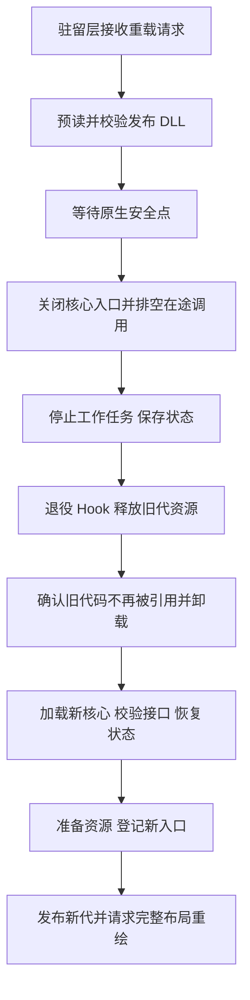

# UnReal World 汉化热重载设计

> Linux 当前协议：ABI 2 驻留桥使用同用户 AF_UNIX 通道和分阶段原生调用，统一队列已接入 `-Reload`。具体实现、ABI 1 迁移限制及交付状态见 [Linux 热更新记录](evidence/20261019-linux-hot-reload.md)。下文 Windows ABI 与历史方案不代替 Linux 的实现边界。

> 2026-10-19：本文为历史协议演进记录。当前要求仍为任意界面内兼容业务模块交接，短 Before/驻留原函数/短 After，不得等待返回 Footer 或让业务调用帧跨原生等待。重建 ABI 1 与历史 ABI 3 不兼容，旧 Applied 回执不是新桥已应用的证据。当前实现及交付状态见 [重建设计](rebuild-design.md) 与 README。

2026-10-19 字体要求：现行规范见 [字体渲染](font-rendering.md)。保留指定字体、固定参考集校准、稳定包络、自然宽度、Blended 抗锯齿及实际输出密度生成字形；这些质量要求不授权全局像素跟踪、保存文字位置或在最终复制时重放。旧 font-design-compliance-static.txt 是代理实现记录，不能作为规范；该引用链及错误正文已更正，见 [出处记录](evidence/20261019-document-render-policy.md)。源码与交付状态以 [README](../README.md) 为准。

绘制边界：Mod 在反编译确认的 UI 组件文本读取处按组件语义生成中文，在该组件当次文字绘制调用中输出高清字形；游戏原生 UI 管理布局、控件及缓存。不得把历史实现记录中的内容镜像、绘制贡献或 RenderCopy 重物化当成这一要求的具体实现。

2026-10-18 最新要求修正：重载必须能在任何游戏界面发起并完成，不要求关闭当前窗口、返回主菜单、手动卸载或重启。此前本文的 Footer 限制和允许 adapter 跨原生等待持有调用帧的描述是旧框架缺陷，不是用户要求，已由本次整改替代。汉化排版与绘制须归游戏原生 UI 管理，旧独立显示计划已经撤除，实际原生字体与构建链交付见 [文字链记录](evidence/native-ui-text-static.txt)，未运行验收；原发现见 [全量静态审查](evidence/native-ui-ownership-audit.txt)。

本次通用桥将原生调用分为 Before / 驻留原函数 / After：adapter 的两个阶段均为短调用，原生函数执行和阻塞等待时不保留业务 DLL 返回地址或租约。稳定驻留事件桥按 SDL 导入名接入 Poll、Wait、Peep、Pump、Delay 和 Present，不识别具体界面；Wait 内部超时只供处理控制事务，不向游戏返回伪事件或内部超时。PREPARE 后原线程停留在驻留服务循环，正式归档替换及 COMMIT 完成后继续原生等待。

HostApi 布局及 Host ABI 保持 `3`；adapter 调度协议与状态模式显式升级为 `2`，旧驻留桥只接受版本 `1`，不能把新版 adapter 当普通旧桥兼容更新加载。迁移前旧驻留桥没有自身升级能力；用户已退出该旧进程，新桥已完成统一队列编译和正式发布，旧文件先归档到根目录回收。回执、哈希与归档见 [新桥交付记录](evidence/anywhere-reload-static.txt)。未启动游戏或运行验收，不声称运行时 Applied。用户要求本次是本轮整改最后一次退出，后续原生 UI 所有权整改与兼容汉化更新均须在业务模块完成，不再以旧框架限制要求离开当前界面。

2026-10-18 当前隔离修订：Host ABI `3` 将原生汉化适配完整移入第六个可重载模块 `adapter`。驻留 `uwcn_loader.dll` 只包含通用模块管理和 HookHost：稳定 x86 thunk / slot、原函数透传、控制 Hook、租约与发布交接；界面作用域、字段读取、显示抑制、输入适配、补丁描述和中文显示计划由业务模块持有。`adapter` 为 ID `6` / 掩码 `32`，全部六模块掩码为 `63`。兼容的窗口汉化、字号、布局和字体修改都通过业务发布处理；新增已确认的原生调用点按通用登记契约由 adapter 提交，不要求修改驻留层。

adapter 维护原生调用作用域，但不再跨原生输入或动画等待保留业务调用帧和租约；其他五个业务模块也保持同步短调用。交接由通用驻留服务泵协调，不按主菜单或其他界面筛选位置。游戏不持久保存 adapter 函数指针，稳定驻留 thunk / slot 在 adapter 卸载期间仍保有控制和原函数透传能力。下文逐窗口的“只能返回主菜单交接”说明均为迁移前历史，不是现行要求。

五模块到六模块、Host ABI `2` 到 `3` 的迁移属于历史记录。当前任意界面桥迁移已正式发布，后续兼容业务更新使用 `PREPARE → ReadyToPublish → COMMIT → Applied` 事务。源码、编译、正式发布与运行时应用分别记录，禁止代理运行游戏、产物或测试。以下窗口接入记录为迁移前历史，原“新增驻留桥需要重启”的说明不再作为迁移后的业务更新方式；不得因业务内部实现或业务协议变化再次改驻留桥并要求退出。

2026-10-18 主菜单汉化组标识新增两个业务字段。Host 只通过 `metadata/package-identity` 返回通用原始身份字节，首行为 `UWCN_PACKAGE_IDENTITY_V1`，其后为当前六模块及已提交词库的 SHA-256；`main_menu` 自己计算 SHA-256、五位 Base36 与字母数字调整，Host 不生成显示版本，旧 `metadata/translation-version` 入口已移除。正常模块更新或词库刷新后的主菜单计划自动取得对应版本。logo 与两行文字只随中文主菜单计划绘制，显示关闭、计划失效及 Render 退役使用既有生命周期，不增加新的重载边界。本功能随本轮框架迁移采用 Host ABI `3`，首次安装须完整离线发布驻留 DLL、业务模块与词库，再由用户正常启动；不对运行中的游戏执行本次更新。

本次先祖列表页新增 `menu_op::ancestors`，静态依据见 [先祖列表记录](evidence/ancestors-static.txt)。驻留桥仅围住主菜单进入的列表调用，以 `AncestorsRequest` 复制固定字段分支、实际页数和最多七条记录的显示统计，经现有五模块形成计划。原生列表重建时更新快照，首次 present 前完成业务调用，业务租约不跨原生输入等待；打开独立纪念页时暂停列表合成，返回后随原列表重建恢复。姓名、存档死亡描述、排序、分页、键帽及输入动作保留。新增操作与字段不改变既有结构大小和 Host ABI `2`，但驻留桥与配套业务、词库和 profile 须完整离线发布后由用户正常重启，不在列表内执行模块交接。

2026-10-18 鸣谢窗口新增 `menu_op::credits` 与 28 个显示字段，证据见 [鸣谢记录](evidence/credits-static.txt)。新增字段从独立数值 `0x200` 起，旧字段及结构大小不变，Host ABI 仍为 `2`。原主菜单调用、窗口面板、段落和按钮由独立驻留桥包围，业务模块只在短暂的格式化与合成调用中持有租约，不跨原生按键等待；首次与窗口事件重绘复用既有 present 边界。此次包含驻留 DLL 修改，需要完整离线发布后由用户正常重启，不在鸣谢窗口处理模块重载。

2026-10-19 开场诗重新接入：两句引言、原生动态版本和十一句诗通过已确认的原生文字及宽度调用提供中文，沿用当前 ABI 1 通用调用桥。原生表面直接持有中文像素，原生 UI 管理灰度、定色、淡变与输入等待。没有页面快照或 Present 重放，不新增驻留桥；兼容业务及数据通过现有热发布事务交接。此前本段的 ABI 2、驻留快照、离线重启要求均属已撤销旧方案，不能作为当前接入或交付依据。静态证据与实际发布状态见 [开场诗记录](evidence/20261019-intro-poem-native.md)。

2026-10-18 热重载边界修订：业务发布只处理所选模块，多模块使用单一事务；主菜单几何由 layout 的 `DisplayPlan.logical_slot` 统一提供给驻留桥；`Shift+F10` 关闭显示后的 `Shift+F5` 会重新装载并启用。词库与清单替换前归档到项目根 `回收/`。Host ABI 保持 `2`，交接仍在原主菜单外层边界。本次基础桥修正自身涉及驻留 DLL，后续兼容业务和词库迭代使用热更新路径。源码、编译、正式发布和运行时应用分别记录，静态依据见 [修订记录](evidence/hot-reload-fix-static.txt)。

2026-10-19 启动加载重新接入：当前 ABI 1 的通用调用桥已能承载新增调用点，无须 `LoadingRequest` 或驻留 DLL 改动。Adapter 仅在原生文字消费边界借出中文，复用现有即时高清绘制；兼容业务及词库沿统一事务发布。原英文日志、资源键和加载路径保留。此前本段要求新增驻留桥并离线发布，属于已退役实现，不能作为当前限制。静态依据、旧原件与实际交付状态见 [启动加载记录](evidence/20261019-startup-loading-native.md)。

独立模块版本见 [模块化框架设计稿](framework-design.md)。下文保留单核心协议依据；新框架将退役与状态交接缩小到变更 DLL 集合，并补充“构建暂存 → 旧模块退役 → 正式文件发布 → 新模块激活”的时序。当前范围为框架、启动加载、完整开场、主界面、设置界面，以及已授权的关于、鸣谢、退出告别页与先祖列表页汉化；设置界面的全部文本须经反编译提取，依据见 [设置文本静态记录](evidence/setup-options-static.txt)，退出页依据见 [退出告别页静态记录](evidence/farewell-static.txt)。角色创建、读档、物品、百科及其他未经授权界面仍排除，设置选项的原值与行为保持原样。

热重载是首版架构要求，包括数据更新和核心 DLL 更换。参考本机 dfcn 的驻留加载器、版本化核心接口、状态交接和卸载失败留驻机制；URWCN 的 UI 语义入口和 x86 调用约定独立适配。驻留加载器及五个独立业务 DLL 已实现并编译，未运行游戏或产物；当前交付见 [README](../README.md)，下文保留单核心协议的设计依据。

设置界面接入沿用五模块结构：驻留桥提交 `SetupRequest`，`menu_op::setup` 经语义、词库、布局与 SDL 生成显示。该契约升级 Host ABI 至 `2`，驻留层与业务模块必须配套离线发布，由用户完全退出游戏后正常启动生效；不得将此驻留与 ABI 更新当作兼容模块热替换。模块退役、数据提交和重新激活仍只在主菜单外层边界进行，设置界面中的请求等待返回主菜单。

退出告别页沿用这套模块结构，由 `menu_op::farewell` 构建 11 个静态显示字段，在原 present 前合成中文。退出函数、显示调用、原生坐标与颜色依据静态反汇编记录，中文行槽在对应区域内排布；原按键等待和退出动作保持原样。该扩展需要更新驻留桥与业务模块，离线发布后由用户正常重启，不增加新的模块交接边界，也不在退出页处理热重载快捷键。

## 操作与生效范围

| 操作 | 行为 |
| --- | --- |
| 显示开关 | 切换中英文，保留当前核心、数据和捕获状态 |
| 数据刷新 | 更新词库、枚举、句式、显示配置及字体配置，不重新加载核心代码 |
| 业务模块重载 | 更换 adapter 原生 UI 适配、字段读取、语义生成、布局或绘制代码；在主菜单外层交接 |
| 驻留层或接口升级 | 启动器、通用驻留桥或 Host ABI 不兼容时，正常重启游戏后生效 |

默认操作习惯参考 dfcn：`Shift+F10` 仅切换显示；`Ctrl+Shift+F10` 请求数据刷新；`Shift+F5` 在启用时关闭汉化，在已关闭时加载最新核心和数据并启用。旧稿提议的设置菜单“重载汉化”新动作不属于本次设置界面文本汉化范围。快捷键可配置，过滤按键重复并处理失焦，避免长按反复加载。

默认按明确请求刷新，不周期扫描文件，也不在编译过程中自动打开半成品 DLL。开发发布工具可以在完整发布后向驻留层提交重载请求，但发布成功和请求排队不等于交接完成。SDL 如用于快捷键或唤醒，仅承担控制消息，不捕获原文或识别 UI。

## 驻留层与可替换核心

| 所有者 | 内容和生命周期 |
| --- | --- |
| `uwcn_loader.dll` | 进程内驻留：控制入口、重载状态机、模块映像句柄、交接字节、代数与诊断 |
| 驻留 `HookHost` | 通用 x86 thunk / slot、原函数透传、控制 Hook、回调登记、入口门闩、调用租约及补丁生命周期；不识别界面 |
| `uwcn_adapter.dll` | 可替换：原生 UI 作用域、补丁描述、字段读取、输入与显示调用适配、中文显示计划业务 |
| 其他五个业务 DLL | 可替换：字段组织、词库、语义生成、布局、字体与绘制资源 |
| 数据包 | 枚举、术语、句式及可刷新配置；完整候选发布后，由核心在显示事务边界切换 |

驻留 `HookHost` 是 URWCN 为入口寿命增加的设计，不是对 dfcn 现有实现的描述。原生 Hook 先进入驻留桥接，再通过受保护的登记表调用当前核心。核心函数指针只在持有对应代数租约时可调用；关闭入口与取得租约必须使用同一个同步协议，不能只在函数体中递增计数。

没有可用 adapter、入口正在退役或重载失败时，驻留桥接执行原函数路径。旧路由描述及稳定 thunk / slot 保留，兼容 adapter 新代激活时校验并更新 Hook 集合；控制 Hook 的 RVA、ID、参数、标志及退出地址保持不变。驻留桥接格式、寄存器上下文布局或调度协议变化则升级 ABI。补丁登记变化只在已有主菜单 Footer 外层、所有模块租约为零时完成。

## 核心接口

采用显式 x86 调用约定的 C ABI，固定宽度字段，结构包含版本和大小；按明确导出名取得函数表。接口至少表达以下能力，具体签名在实现时固定：

```text
prepare        校验构建适配和数据，准备可启动状态，不启用业务入口
activate       登记并启用本代回调
set_enabled    控制中文显示
request_data   请求完整数据包刷新
save_state     将版本化状态写入驻留层拥有的字节缓冲
restore_state  校验并恢复交接状态，不解引用旧地址
begin_retire   停止接收任务和新回调
shutdown       释放自有状态；无法脱离活动引用时返回 Deferred
```

API 表、函数指针和 build 字符串仅在该核心映像仍被加载时有效。驻留层不接管核心创建的 STL 容器或 C++ 对象；跨边界采用字节副本、固定结构或成对的分配释放服务，异常不得穿越 ABI。

若 UI 会保存中文字符串指针，文本通过驻留层的 arena 复制后交付，核心只提交字节和生命周期标识。退役核心不释放这些外部仍在使用的文本；在已验证的 UI 结束或字段重新绑定后才回收。这个 arena 只持有字节，不持有旧核心 deleter 或函数对象。同步消费且不持有指针的入口仍可使用调用内缓冲。

导出一个无指针的静态描述符，允许驻留层在执行 DLL 代码前读取架构、接口版本、结构大小和状态格式范围。URWCN 检查 I386 与 PE32；dfcn 当前的 AMD64、PE32+ 验证器不能直接复制。

## 数据热刷新

主界面字体的候选度量、输出目标代数与资源归属按 [高清字体渲染与自适应方案](font-rendering.md) 细化，并沿用下述完整候选包与字体共同提交的规则。

词库、枚举、句式、配置及索引先构成完整 `CatalogBundle`。解析、语义键及引用关系失败时保留旧包，不发布半份配置。多文件数据包通过版本清单或完成标记确定一致版本，文件写入完成后才发刷新请求。

字体设置变化时，候选阶段就在绘制所属线程准备新字体；准备失败保留旧包、旧字体配置及原有布局，不发布候选配置。字体不变时可复用现有字体资源。

在 UI 布局事务边界，将候选包、字体配置和对应字体资源作为同一个发布状态提交，递增 `catalog_generation`，字体变化时同时递增 `font_generation`。随后重新布局并作废受影响纹理。一次测量、绘制和命中查询保持同代；现存计划继续持有对应的旧数据及旧字体直到本次显示结束，最后一个引用退休后再释放。只改字号、句式或词库不重新安装原生 Hook。

原生字段偏移、ABI 和 Hook 地址属于构建适配，不能按普通词库即时修改；这类变化随兼容核心重载，在退役窗口重新校验并登记。

## 核心交接



1. 驻留层先读取完整发布映像并校验 PE、导出描述符和接口，交接期间保持已校验文件内容稳定。预检失败不拆旧入口。
2. 在已确认的主菜单 Footer 外层执行交接。adapter 内菜单和 Hook 只提交请求，原生输入等待可以保有 adapter 租约，必须等其返回、全部模块租约清零后，在进入下一次 adapter dispatch 前处理，禁止在旧 adapter 调用栈上卸载自己。
3. 关闭进入旧代的门闩，等待已取得租约的回调结束。核对其他可能调用 UI、事件或渲染 Hook 的线程；仅“当前线程是 SDL 线程”或某次计数为零不足以证明可以退役。
4. 停止接收后台任务，取消或排空自有工作并 join，不持有工作线程退出所需的锁。在稳定状态下保存快照；需要其他线程执行退役时，交接延后到下一安全点，不阻塞其进度。
5. adapter 作废自有计划并恢复中文几何，Host 清除旧函数表与映像引用。游戏只保存指向驻留 thunk 的入口；原路由描述、控制 Hook 和原函数透传路径保持驻留，不保存旧 adapter 回调指针。新代激活时按已确认原始字节替换补丁集合。
6. 在绘制所属线程由 adapter 作废旧 `DisplayPlan`，由 render 释放相应字形、纹理、字体及自有缓存，再卸载变更模块。loader 不包含 `FieldId` / `DisplayPlan` 定义，也不解释其布局；词库候选失败时的 adapter 快照只作为不透明缓冲短暂交回，不归驻留层解释或长期保存。
7. 加载新核心，核对 C ABI，恢复状态并准备新资源。原生入口仍关闭，直到本代全部准备完成后才发布函数表、递增 `core_generation` 并开放调用。
8. 已打开面板自动作废旧布局并请求重绘，保留当前选择和滚动语义。用已保存快照或下一次原生业务调用重新绑定字段，无需关闭界面、重新选择对象或等待新事件才生效。

当前 UnReal World 交接只采用静态证据已确认的主菜单 Footer 外层路径，地址与原生分支见 [框架设计](framework-design.md)。不把此路径外推为任意界面的交接点，也不以静态实现说明代替运行验收；代理不执行游戏运行和模块卸载验证。

## 跨代状态

驻留层只保留有版本、长度和类型的交接字节，不保留旧核心对象。状态头包含格式版本、游戏指纹、世界及会话代数、语义 schema 版本和记录数量；解码检查范围，未知可选记录可跳过，必需记录不兼容则拒绝交接。

序列化对象和事件中已经解码的语义值，不把 `0xAC` 原始对象描述或任意内存块视为稳定的跨代结构。内部 handle、关联对象和可见性经过显式编码；恢复后需要活体对象时仍重新验证来源。

| 保留 | 重建或重新绑定 |
| --- | --- |
| 中英文开关、运行期字体及语言选择 | 字体句柄、纹理、surface、字形及排版缓存 |
| 事件发生时的类型、分支、数值和可见名称快照 | 函数指针、trampoline、虚表、回调及 TLS 对象 |
| 有来源身份的原显示副本及 UI 字段关联数据 | 游戏对象裸指针和共享文本池返回指针 |
| 已打开界面的语义选择、滚动锚点及可恢复显示状态 | 当前几何和鼠标命中区域 |

保存的对象或行地址即使作为数值身份记录，也须结合世界代数在原生回调中重新核对，不能恢复后直接解引用。旧核心最后一代计划不得进入新核心；清理必须在卸载前执行，不能等新核心里的引用计数归零。

历史事件只使用发生时的快照。Mod 独有、游戏没有保留语义的事件记录必须有兼容迁移或原显示副本，不能像可恢复的 UI 缓存一样丢弃，再读取对象现状重造历史。数据刷新或核心更换可以更新中文措辞，但不能改变事件当时的事实。

`core_generation`、`catalog_generation`、`font_generation`、`world_generation` 和 `ui_generation` 分开维护。重载核心不意味着世界变化，也不能使旧布局继续生效。

## 卸载和失败处理

核心拥有的后台线程、任务队列和线程局部缓存必须能够在退役时释放。参考 dfcn 的“模块拥有对象，TLS 只保留平凡指针”方式；对象仍须在全部使用者静默后清理，不能在其他线程仍使用时直接清空注册表。驻留 TLS 槽若保存代数或指针，核心退役时须清除并以代数防止复用。

Windows 首版参考 dfcn 的正式路径加载，不生成运行副本或历史 DLL 备份。发布端仅在构建成功后替换正式产物；加载端预检和持有已验证文件，旧映像完全释放后再打开新的正式映像。不在游戏中编译，不通过反复加载同路径规避仍被引用的旧映像。

构建和发布接收同一六模块集合：`catalog`、`semantic`、`render`、`layout`、`main_menu`、`adapter`。所有编译请求进入项目根 `build.ps1` 或 `build-queue.ps1`，兼容请求合并为一个批次；不通过其他构建入口绕过队列。adapter 更新使用相同掩码、清单、静态描述符和六模块 `Applied` 回执核对，不建立第二套发布协议。

首次六模块迁移只允许完整离线发布。正式根仍为根目录 `uwcn_launcher.exe` 与 `package/`；旧文件先移到 `回收/<批次>/` 并保留相对路径，随后写入新文件。若正式文件仍被运行中游戏占用，须由用户完全退出后继续原位置发布，不改用独立修复包或构建目录启动器。`-Reload` 只发布选中的兼容业务模块，不修改启动器、驻留 DLL 或 profile。

| 失败位置 | 行为 |
| --- | --- |
| 发布文件不完整或描述符不兼容 | 拒绝交接，保留现有代和控制入口 |
| 保存必需状态失败 | 不卸载旧代，保持 Disabled 及其数据、映像供重试；已停止的队列不通过重新打开门闩假装恢复 |
| 在途回调或 Hook 尚未退役 | Deferred；旧代码和依赖资源继续留驻，关闭中文输出，稍后安全重试 |
| 旧映像无法释放 | 不加载冲突新代，不宣称完成；保留诊断和控制入口 |
| 旧代卸载后，新核心加载、恢复或初始化失败 | 保持原文和驻留控制，保留交接字节供重试；不声称自动恢复旧 DLL |
| 新代部分登记失败 | 关闭入口并撤销已登记部分；引用尚在时留驻该映像，不强制卸载 |

状态机明确区分 Ready、ReloadRequested、Quiescing、Deferred、Disabled 和 Failed。只有新代完成恢复、激活和发布后才记录重载成功；构建时间或文件存在不能替代运行时代数。

## dfcn 源码依据

本次只读参考 `D:\workspace\dfcn`，没有修改、编译、部署或操作其游戏。

- [core_api.h](D:/workspace/dfcn/src/core_api.h:12)：驻留层与核心的 C ABI 4、接口大小、save/restore，以及 shutdown 返回 false 时禁止卸载的约定。
- [loader.cpp](D:/workspace/dfcn/src/loader.cpp:109)：候选准备、交接字节、停止旧代、加载及初始化新代；Windows 后段失败不自动回滚旧 DLL。
- [core_module.h](D:/workspace/dfcn/src/core_module.h:84)：Windows 非 eager load，先锁定并预读正式文件，释放旧引用后再 LoadLibraryEx；没有 shadow DLL。
- [core_image_format.h](D:/workspace/dfcn/src/core_image_format.h:40)：静态 PE 描述符验证；现有实现限定 AMD64，URWCN 应改为 x86 设计。
- [native_hooks.inc](D:/workspace/dfcn/src/native_hooks.inc:356)：先停止自有工作，再卸 Hook，确认 detached 和 idle 后才释放 overlay 与资源。
- [core_reload.inc](D:/workspace/dfcn/src/core_reload.inc:530)：跨代序列化原生段落、文档、行身份及历史语义记录。
- [reloadable_thread_state.h](D:/workspace/dfcn/src/reloadable_thread_state.h:9)：模块持有线程缓存对象，TLS 只存平凡指针，依赖已证实的安全交接边界。
- [loader.cpp](D:/workspace/dfcn/src/loader.cpp:338)：现行 F5 核心重载、F10 显示开关和 Ctrl Shift F10 数据刷新；以实现区分三者。
- [dfcn.cpp](D:/workspace/dfcn/src/dfcn.cpp:7894) 与 [rule_catalog_loading.inc](D:/workspace/dfcn/src/rule_catalog_loading.inc:332)：显式数据刷新请求和候选词库构建再提交；URWCN 进一步将整套可刷新配置纳入同一 CatalogBundle。

